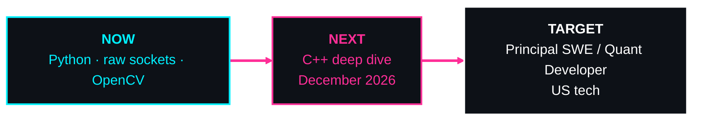

<div align="center">


<a href="https://github.com/SCUIZZYBYTES">
  
</a>

<br/>


</div>

<!-- psst: you're reading raw markdown. respect. -->

<br/>

## `>_ whoami`

I'm a **software engineer in training** who wants to know how things work one layer down — **packets, pixels, processes**.

I write **Python every day**, start a deep dive into **C++ in December 2026**, and I'm building toward **Principal Software Engineer / Quant Developer** in the **US tech industry**.

| Domain | Tooling |
| :-- | :-- |
| Desktop apps | CustomTkinter |
| Games | Pygame |
| Computer vision | OpenCV · NumPy |
| Packet-level networking | raw sockets (`AF_PACKET`) · bitmasks · data structures |
| System monitoring & terminal UIs | psutil · rich |

<br/>

## `>_ fastfetch`

```text
┌──[ scuizzybytes@github ]──────────────────────────────────────
│
│  OS       ▸  Windows 11 + Linux Mint Cinnamon  (dual-boot)
│  EDITORS  ▸  PyCharm · VS Code
│  TERMINAL ▸  btop · fastfetch
│  STACK    ▸  Python (daily)  →  C++ (target: Dec 2026)
│  GEAR     ▸  Aula Win60 HE Max  (custom magnetic switches)
│  BASE     ▸  Germany
│  LANGS    ▸  RU · DE · EN
│  STATUS   ▸  leveling up
│  TARGET   ▸  Principal SWE / Quant Dev  (US tech scene)
│
└────────────────────────────────────────────── ░▒▓█ online █▓▒░
```

<br/>

## `>_ arsenal`

<p align="center">
  <sub><code>// LANGUAGES</code></sub><br/>
  
  
</p>

<p align="center">
  <sub><code>// PYTHON LIBS</code></sub><br/>
  
  
  
  
  
  
</p>

<p align="center">
  <sub><code>// LOW-LEVEL</code></sub><br/>
  
</p>

<p align="center">
  <sub><code>// ENVIRONMENT</code></sub><br/>
  
  
  
  
</p>

<br/>

## `>_ roadmap`



<br/>

## `>_ contributions`

<div align="center">
<picture>
  <source media="(prefers-color-scheme: dark)" srcset="https://raw.githubusercontent.com/SCUIZZYBYTES/SCUIZZYBYTES/output/github-snake-dark.svg" />
  <source media="(prefers-color-scheme: light)" srcset="https://raw.githubusercontent.com/SCUIZZYBYTES/SCUIZZYBYTES/output/github-snake.svg" />
  
</picture>
</div>

<br/>

<details>
<summary><b>RU · Русская версия</b></summary>

<br/>

### `>_ whoami`

Я — **начинающий software engineer**, которому интересно, как всё устроено на уровень ниже: **пакеты, пиксели, процессы**. Каждый день пишу на **Python**, в **декабре 2026** начинаю глубокое погружение в **C++** и иду к цели — **Principal Software Engineer / Quant Developer** в **американской tech-индустрии**.

| Направление | Инструменты |
| :-- | :-- |
| Десктопные приложения | CustomTkinter |
| Игры | Pygame |
| Компьютерное зрение | OpenCV · NumPy |
| Сетевой уровень пакетов | raw sockets (`AF_PACKET`) · битовые маски · структуры данных |
| Мониторинг системы и терминальные UI | psutil · rich |

### `>_ setup`

| | |
| :-- | :-- |
| ОС | Windows 11 + Linux Mint Cinnamon (dual-boot) |
| Редакторы | PyCharm · VS Code |
| Терминал | btop · fastfetch |
| Клавиатура | Aula Win60 HE Max (кастомные магнитные свитчи) |

### `>_ roadmap`

```text
СЕЙЧАС  ▸  Python · raw sockets · OpenCV
ДАЛЕЕ   ▸  глубокое погружение в C++ (декабрь 2026)
ЦЕЛЬ    ▸  Principal SWE / Quant Developer (US tech)
```

</details>

<br/>


