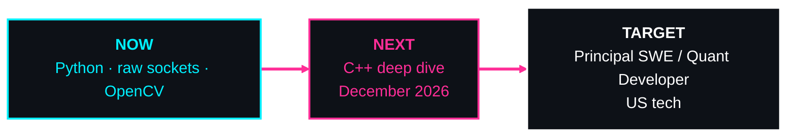

<svg xmlns="http://www.w3.org/2000/svg" width="800" height="360" viewBox="0 0 800 360" role="img" aria-label="SCUIZZYBYTES — low-level code, systems, quant trajectory" xmlns:c2pa="http://c2pa.org/manifest"><metadata><c2pa:manifest>AAAWgmp1bWIAAAAeanVtZGMycGEAEQAQgAAAqgA4m3EDYzJwYQAAABZcanVtYgAAAEdqdW1kYzJtYQARABCAAACqADibcQN1cm46YzJwYTozYmQ5OWYxOC1lMWY1LTQ5ZTQtYjkyNC05N2VlZDg2NWQ5ZWYAAAADl2p1bWIAAAApanVtZGMyYXMAEQAQgAAAqgA4m3EDYzJwYS5hc3NlcnRpb25zAAAAALxqdW1iAAAARGp1bWRjYm9yABEAEIAAAKoAOJtxE2MycGEuaW5ncmVkaWVudC52MwAAAAAYYzJzaOb1Cdo/2c6S/FKRa7iyaQQAAABwY2JvcqNpZGM6Zm9ybWF0bWltYWdlL3N2Zyt4bWxqaW5zdGFuY2VJRHgseG1wOmlpZDowNTUxYTExOC01N2ExLTQ5NTYtYWIxMS0zN2U5MDQyMGJkM2FscmVsYXRpb25zaGlwaHBhcmVudE9mAAAB4mp1bWIAAABBanVtZGNib3IAEQAQgAAAqgA4m3ETYzJwYS5hY3Rpb25zLnYyAAAAABhjMnNoPqyO63SyRf63erMfGArH3wAAAZljYm9yomdhY3Rpb25zgqJmYWN0aW9ua2MycGEub3BlbmVkanBhcmFtZXRlcnOha2luZ3JlZGllbnRzgaJjdXJseC1zZWxmI2p1bWJmPWMycGEuYXNzZXJ0aW9ucy9jMnBhLmluZ3JlZGllbnQudjNkaGFzaFggfc2FaMWB25QMrm34RaAif/BigzBYAi/jquBuXgkKxKakZmFjdGlvbngdY29tLmFudGhyb3BpYy5jbGF1ZGUucHJvdmlkZWRqcGFyYW1ldGVyc6F4H2NvbS5hbnRocm9waWMub3JpZ2luLWNvbmZpZGVuY2VndW5rbm93bmtkZXNjcmlwdGlvbnhmQ2xhdWRlIHByb3ZpZGVkIHRoaXMgZmlsZSBhdCB0aGUgcmVxdWVzdCBvZiBhIHVzZXIgYW5kIG1heSBoYXZlIGNyZWF0ZWQgb3IgbW9kaWZpZWQgdGhlIGZpbGUgY29udGVudHMubXNvZnR3YXJlQWdlbnShZG5hbWVmQ2xhdWRlcmFsbEFjdGlvbnNJbmNsdWRlZPUAAADIanVtYgAAAEBqdW1kY2JvcgARABCAAACqADibcRNjMnBhLmhhc2guZGF0YQAAAAAYYzJzaDl99kEHPvO6lhMAgo2tvcQAAACAY2JvcqVjYWxnZnNoYTI1NmNwYWRNAAAAAAAAAAAAAAAAAGRoYXNoWCBuCXeJTym5waYsNciDM4kqzp8lj3NbqLfgC8eAh6U8i2RuYW1lbmp1bWJmIG1hbmlmZXN0amV4Y2x1c2lvbnOBomVzdGFydBjpZmxlbmd0aBkeBAAAAj5qdW1iAAAAJ2p1bWRjMmNsABEAEIAAAKoAOJtxA2MycGEuY2xhaW0udjIAAAACD2Nib3KlY2FsZ2ZzaGEyNTZpc2lnbmF0dXJleE1zZWxmI2p1bWJmPS9jMnBhL3VybjpjMnBhOjNiZDk5ZjE4LWUxZjUtNDllNC1iOTI0LTk3ZWVkODY1ZDllZi9jMnBhLnNpZ25hdHVyZWppbnN0YW5jZUlEeCx4bXA6aWlkOjA5ZGYxYTQ4LWUyZTYtNDhhYS04NjQzLTQ5NWVjYjk5MTZhNXJjcmVhdGVkX2Fzc2VydGlvbnODomN1cmx4LXNlbGYjanVtYmY9YzJwYS5hc3NlcnRpb25zL2MycGEuaW5ncmVkaWVudC52M2RoYXNoWCB9zYVoxYHblAyubfhFoCJ/8GKDMFgCL+Oq4G5eCQrEpqJjdXJseCpzZWxmI2p1bWJmPWMycGEuYXNzZXJ0aW9ucy9jMnBhLmFjdGlvbnMudjJkaGFzaFggAeQHMu2fJ0UFQniDtBc/+Cp4Y5l9f9MTlNu9yAjEddSiY3VybHgpc2VsZiNqdW1iZj1jMnBhLmFzc2VydGlvbnMvYzJwYS5oYXNoLmRhdGFkaGFzaFggIwAaSYF1xb7TDKYjK4CJp7QW6bUvGRC5QUQzE/NEShp0Y2xhaW1fZ2VuZXJhdG9yX2luZm+jZG5hbWVvQW50aHJvcGljIEZpbGVzZ3ZlcnNpb25lMS4wLjBrc3BlY1ZlcnNpb25lMi40LjAAABA4anVtYgAAAChqdW1kYzJjcwARABCAAACqADibcQNjMnBhLnNpZ25hdHVyZQAAABAIY2JvctKEWQISogEmGCFZAgowggIGMIIBjaADAgECAhRA5aAK7sI50L64g/oGQgU9Z1UTADAKBggqhkjOPQQDAzBJMRcwFQYDVQQKEw5BbnRocm9waWMsIFBCQzEuMCwGA1UEAxMlQW50aHJvcGljIENvbnRlbnQgQ3JlZGVudGlhbHMgUm9vdCBDQTAeFw0yNjA4MDcxODQzNTZaFw0yODA4MDYxOTQzNTZaMEQxFzAVBgNVBAoTDkFudGhyb3BpYywgUEJDMSkwJwYDVQQDEyBBbnRocm9waWMgQ2xhdWRlIENvbnRlbnQgU2lnbmluZzBZMBMGByqGSM49AgEGCCqGSM49AwEHA0IABJh6CmvLUBgFFNU0vUKlOVtE6djd17L5SuwX0LemFisBM3dkd/3cyjxFA3Qo5S46fX0/ihY0VZ7mfb9KF703t5OjWDBWMA4GA1UdDwEB/wQEAwIHgDAVBgNVHSUEDjAMBgorBgEEAYPoXgIBMAwGA1UdEwEB/wQCMAAwHwYDVR0jBBgwFoAUzlHiBIFOZFsj+OPEz5o+nMHXXMIwCgYIKoZIzj0EAwMDZwAwZAIwMXMdFJ4BetLLVY7ORuE9noqbbAZOZn/aArXyTwFAZfKrPzxF2vPoJNf1+UCdg1XGAjBwX1zd9WGqYkqmL5SFqw1QySjr1zJfpJM9+1rdDwSPLMOPOjKuiXjoU/pUUeG9RwmhY3BhZFkNngAAAAAAAAAAAAAAAAAAAAAAAAAAAAAAAAAAAAAAAAAAAAAAAAAAAAAAAAAAAAAAAAAAAAAAAAAAAAAAAAAAAAAAAAAAAAAAAAAAAAAAAAAAAAAAAAAAAAAAAAAAAAAAAAAAAAAAAAAAAAAAAAAAAAAAAAAAAAAAAAAAAAAAAAAAAAAAAAAAAAAAAAAAAAAAAAAAAAAAAAAAAAAAAAAAAAAAAAAAAAAAAAAAAAAAAAAAAAAAAAAAAAAAAAAAAAAAAAAAAAAAAAAAAAAAAAAAAAAAAAAAAAAAAAAAAAAAAAAAAAAAAAAAAAAAAAAAAAAAAAAAAAAAAAAAAAAAAAAAAAAAAAAAAAAAAAAAAAAAAAAAAAAAAAAAAAAAAAAAAAAAAAAAAAAAAAAAAAAAAAAAAAAAAAAAAAAAAAAAAAAAAAAAAAAAAAAAAAAAAAAAAAAAAAAAAAAAAAAAAAAAAAAAAAAAAAAAAAAAAAAAAAAAAAAAAAAAAAAAAAAAAAAAAAAAAAAAAAAAAAAAAAAAAAAAAAAAAAAAAAAAAAAAAAAAAAAAAAAAAAAAAAAAAAAAAAAAAAAAAAAAAAAAAAAAAAAAAAAAAAAAAAAAAAAAAAAAAAAAAAAAAAAAAAAAAAAAAAAAAAAAAAAAAAAAAAAAAAAAAAAAAAAAAAAAAAAAAAAAAAAAAAAAAAAAAAAAAAAAAAAAAAAAAAAAAAAAAAAAAAAAAAAAAAAAAAAAAAAAAAAAAAAAAAAAAAAAAAAAAAAAAAAAAAAAAAAAAAAAAAAAAAAAAAAAAAAAAAAAAAAAAAAAAAAAAAAAAAAAAAAAAAAAAAAAAAAAAAAAAAAAAAAAAAAAAAAAAAAAAAAAAAAAAAAAAAAAAAAAAAAAAAAAAAAAAAAAAAAAAAAAAAAAAAAAAAAAAAAAAAAAAAAAAAAAAAAAAAAAAAAAAAAAAAAAAAAAAAAAAAAAAAAAAAAAAAAAAAAAAAAAAAAAAAAAAAAAAAAAAAAAAAAAAAAAAAAAAAAAAAAAAAAAAAAAAAAAAAAAAAAAAAAAAAAAAAAAAAAAAAAAAAAAAAAAAAAAAAAAAAAAAAAAAAAAAAAAAAAAAAAAAAAAAAAAAAAAAAAAAAAAAAAAAAAAAAAAAAAAAAAAAAAAAAAAAAAAAAAAAAAAAAAAAAAAAAAAAAAAAAAAAAAAAAAAAAAAAAAAAAAAAAAAAAAAAAAAAAAAAAAAAAAAAAAAAAAAAAAAAAAAAAAAAAAAAAAAAAAAAAAAAAAAAAAAAAAAAAAAAAAAAAAAAAAAAAAAAAAAAAAAAAAAAAAAAAAAAAAAAAAAAAAAAAAAAAAAAAAAAAAAAAAAAAAAAAAAAAAAAAAAAAAAAAAAAAAAAAAAAAAAAAAAAAAAAAAAAAAAAAAAAAAAAAAAAAAAAAAAAAAAAAAAAAAAAAAAAAAAAAAAAAAAAAAAAAAAAAAAAAAAAAAAAAAAAAAAAAAAAAAAAAAAAAAAAAAAAAAAAAAAAAAAAAAAAAAAAAAAAAAAAAAAAAAAAAAAAAAAAAAAAAAAAAAAAAAAAAAAAAAAAAAAAAAAAAAAAAAAAAAAAAAAAAAAAAAAAAAAAAAAAAAAAAAAAAAAAAAAAAAAAAAAAAAAAAAAAAAAAAAAAAAAAAAAAAAAAAAAAAAAAAAAAAAAAAAAAAAAAAAAAAAAAAAAAAAAAAAAAAAAAAAAAAAAAAAAAAAAAAAAAAAAAAAAAAAAAAAAAAAAAAAAAAAAAAAAAAAAAAAAAAAAAAAAAAAAAAAAAAAAAAAAAAAAAAAAAAAAAAAAAAAAAAAAAAAAAAAAAAAAAAAAAAAAAAAAAAAAAAAAAAAAAAAAAAAAAAAAAAAAAAAAAAAAAAAAAAAAAAAAAAAAAAAAAAAAAAAAAAAAAAAAAAAAAAAAAAAAAAAAAAAAAAAAAAAAAAAAAAAAAAAAAAAAAAAAAAAAAAAAAAAAAAAAAAAAAAAAAAAAAAAAAAAAAAAAAAAAAAAAAAAAAAAAAAAAAAAAAAAAAAAAAAAAAAAAAAAAAAAAAAAAAAAAAAAAAAAAAAAAAAAAAAAAAAAAAAAAAAAAAAAAAAAAAAAAAAAAAAAAAAAAAAAAAAAAAAAAAAAAAAAAAAAAAAAAAAAAAAAAAAAAAAAAAAAAAAAAAAAAAAAAAAAAAAAAAAAAAAAAAAAAAAAAAAAAAAAAAAAAAAAAAAAAAAAAAAAAAAAAAAAAAAAAAAAAAAAAAAAAAAAAAAAAAAAAAAAAAAAAAAAAAAAAAAAAAAAAAAAAAAAAAAAAAAAAAAAAAAAAAAAAAAAAAAAAAAAAAAAAAAAAAAAAAAAAAAAAAAAAAAAAAAAAAAAAAAAAAAAAAAAAAAAAAAAAAAAAAAAAAAAAAAAAAAAAAAAAAAAAAAAAAAAAAAAAAAAAAAAAAAAAAAAAAAAAAAAAAAAAAAAAAAAAAAAAAAAAAAAAAAAAAAAAAAAAAAAAAAAAAAAAAAAAAAAAAAAAAAAAAAAAAAAAAAAAAAAAAAAAAAAAAAAAAAAAAAAAAAAAAAAAAAAAAAAAAAAAAAAAAAAAAAAAAAAAAAAAAAAAAAAAAAAAAAAAAAAAAAAAAAAAAAAAAAAAAAAAAAAAAAAAAAAAAAAAAAAAAAAAAAAAAAAAAAAAAAAAAAAAAAAAAAAAAAAAAAAAAAAAAAAAAAAAAAAAAAAAAAAAAAAAAAAAAAAAAAAAAAAAAAAAAAAAAAAAAAAAAAAAAAAAAAAAAAAAAAAAAAAAAAAAAAAAAAAAAAAAAAAAAAAAAAAAAAAAAAAAAAAAAAAAAAAAAAAAAAAAAAAAAAAAAAAAAAAAAAAAAAAAAAAAAAAAAAAAAAAAAAAAAAAAAAAAAAAAAAAAAAAAAAAAAAAAAAAAAAAAAAAAAAAAAAAAAAAAAAAAAAAAAAAAAAAAAAAAAAAAAAAAAAAAAAAAAAAAAAAAAAAAAAAAAAAAAAAAAAAAAAAAAAAAAAAAAAAAAAAAAAAAAAAAAAAAAAAAAAAAAAAAAAAAAAAAAAAAAAAAAAAAAAAAAAAAAAAAAAAAAAAAAAAAAAAAAAAAAAAAAAAAAAAAAAAAAAAAAAAAAAAAAAAAAAAAAAAAAAAAAAAAAAAAAAAAAAAAAAAAAAAAAAAAAAAAAAAAAAAAAAAAAAAAAAAAAAAAAAAAAAAAAAAAAAAAAAAAAAAAAAAAAAAAAAAAAAAAAAAAAAAAAAAAAAAAAAAAAAAAAAAAAAAAAAAAAAAAAAAAAAAAAAAAAAAAAAAAAAAAAAAAAAAAAAAAAAAAAAAAAAAAAAAAAAAAAAAAAAAAAAAAAAAAAAAAAAAAAAAAAAAAAAAAAAAAAAAAAAAAAAAAAAAAAAAAAAAAAAAAAAAAAAAAAAAAAAAAAAAAAAAAAAAAAAAAAAAAAAAAAAAAAAAAAAAAAAAAAAAAAAAAAAAAAAAAAAAAAAAAAAAAAAAAAAAAAAAAAAAAAAAAAAAAAAAAAAAAAAAAAAAAAAAAAAAAAAAAAAAAAAAAAAAAAAAAAAAAAAAAAAAAAAAAAAAAAAAAAAAAAAAAAAAAAAAAAAAAAAAAAAAAAAAAAAAAAAAAAAAAAAAAAAAAAAAAAAAAAAAAAAAAAAAAAAAAAAAAAAAAAAAAAAAAAAAAAAAAAAAAAAAAAAAAAAAAAAAAAAAAAAAAAAAAAAAAAAAAAAAAAAAAAAAAAAAAAAAAAAAAAAAAAAAAAAAAAAAAAAAAAAAAAAAAAAAAAAAAAAAAAAAAAAAAAAAAAAAAAAAAAAAAAAAAAAAAAAAAAAAAAAAAAAAAAAAAAAAAAAAAAAAAAAAAAAAAAAAAAAAAAAAAAAAAAAAAAAAAAAAAAAAAAAAAAAAAAAAAAAAAAAAAAAAAAAAAAAAAAAAAAAAAAAAAAAAAAAAAAAAAAAAAAAAAAAAAAAAAAAAAAAAAAAAAAAAAAAAAAAAAAAAAAAAAAAAAAAAAAAAAAAAAAAAAAAAAAAAAAAAAAAAAAAAAAAAAAAAAAAAAAAAAAAAAAAAAAAAAAAAAAAAAAAAAAAAAAAAAAAAAAAAAAAAAAAAAAAAAAAAAAAAAAAAAAAAAAAAAAAAAAAAAAAAAAAAAAAAAAAAAAAAAAAAAAAAAAAAAAAAAAAAAAAAAAAAAAAAAAAAAAAAAAAAAAAAAAAAAAAAAAAAAAAAAAAAAAAAAAAAAAAAAAAAAAAAAAAAAAAAAAAAAAAAAAAAAAAAAAAAAAAAAAAAAAAAAAAAAAAAAAAAAAAAAAAAAAAAAAAAAAAAAAAAAAAAAAAAAAAAAAAAAAAAAAAAAAAAAAAAAAAAAAAAAAAAAAAAAAAAAAAAAAAAAAAAAAAAAAAAAAAAAAAAAAAAAAAAAAAAAAAAAAAAAAAAAAAAAAAAAAAAAAAAAAAAAAAAAAAAAAAAAAAAAAAAAAAAAAAAAAAAAAAAAAAAAAAAAAAAAAAAAAAAAAAAAAAAAAAAAAAAAAAAAAAAAAAAAAAAAAAAAAAAAAAAAAAAAAAAAAAAAAAAAAAAAAAAAAAAAAAAAAAAAAAAAAAAAAAAAAAAAAAAAAAAAAAAAAAAAAAAAAAAAAAAAAAAAAAAAAAAAAAAAAAAAAAAAAAAAAAAAAAAAAAAAAAAAAAAAAAAAAAAAAPZYQNp9+8AtEZJtHHXSGx6DTpIfdbZ4npUB6LZ9Fpaf5SPpYtL+XEKDG1R4bDyNj3PM0DPukfU1+K6+/CMXHU9lvsM=</c2pa:manifest></metadata>
<title>SCUIZZYBYTES — low-level code, systems, quant trajectory</title>
<defs>
 
<linearGradient id="bg" x1="0" y1="0" x2="0" y2="1"><stop offset="0" stop-color="#03050A"/><stop offset=".6" stop-color="#0A0918"/><stop offset="1" stop-color="#190A26"/></linearGradient>
<radialGradient id="skyglow" cx="400" cy="238" r="330" gradientUnits="userSpaceOnUse"><stop offset="0" stop-color="#FF2E97" stop-opacity=".42"/><stop offset=".55" stop-color="#8A2BFF" stop-opacity=".12"/><stop offset="1" stop-color="#8A2BFF" stop-opacity="0"/></radialGradient>
<linearGradient id="sun" x1="0" y1="188" x2="0" y2="238" gradientUnits="userSpaceOnUse"><stop offset="0" stop-color="#FF63AE"/><stop offset=".55" stop-color="#FF2E97"/><stop offset="1" stop-color="#8A2BFF"/></linearGradient>
<linearGradient id="floor" x1="0" y1="238" x2="0" y2="360" gradientUnits="userSpaceOnUse"><stop offset="0" stop-color="#16062C"/><stop offset="1" stop-color="#05030C"/></linearGradient>
<radialGradient id="vig" cx="400" cy="180" r="470" gradientUnits="userSpaceOnUse"><stop offset=".55" stop-color="#000" stop-opacity="0"/><stop offset="1" stop-color="#000" stop-opacity=".6"/></radialGradient>
<pattern id="scan" width="4" height="4" patternUnits="userSpaceOnUse"><rect width="4" height="1" fill="#fff" opacity=".045"/></pattern>
<filter id="glowC" x="-10%" y="-40%" width="120%" height="180%"><feGaussianBlur stdDeviation="3.2" result="b"/><feMerge><feMergeNode in="b"/><feMergeNode in="SourceGraphic"/></feMerge></filter>
<filter id="blur2" x="-5%" y="-400%" width="110%" height="900%"><feGaussianBlur stdDeviation="2"/></filter>
<clipPath id="frame"><rect width="800" height="360" rx="16"/></clipPath>
<mask id="sunmask" maskUnits="userSpaceOnUse" x="0" y="0" width="800" height="360"><rect width="800" height="360" fill="#fff"/><rect x="0" y="229" width="800" height="3" fill="#000"/><rect x="0" y="220" width="800" height="4" fill="#000"/><rect x="0" y="210" width="800" height="5" fill="#000"/><rect x="0" y="199" width="800" height="6" fill="#000"/></mask>
 
<style><![CDATA[
text{font-family:ui-monospace, SFMono-Regular, "SF Mono", Menlo, Consolas, "Liberation Mono", "DejaVu Sans Mono", monospace}
@media (prefers-reduced-motion: reduce){*{animation:none !important}}
 
.ta{transform:translate(3px,0);animation:ga 7s infinite steps(1,end)}
.tb{transform:translate(-3px,0);animation:gb 7s infinite steps(1,end)}
.tm{animation:flick 7s infinite}
.grid line{stroke:#00F0FF;stroke-opacity:.26;stroke-width:1}
.mv{animation:mv 6s cubic-bezier(.55,0,.95,.55) infinite}
.mvl{stroke:#FF2E97;stroke-width:1.6;opacity:0;animation:mvf 6s linear infinite}
.blink{animation:blink 1.4s steps(1,end) infinite}
.ty1,.ty2,.ty3,.cr{opacity:0}
@keyframes flick{0%{opacity:1}90%{opacity:1}91%{opacity:.6}92%{opacity:1}94%{opacity:.75}95%{opacity:1}100%{opacity:1}}
@keyframes ga{0%{transform:translate(3px,0)}90%{transform:translate(-7px,1px)}91.5%{transform:translate(8px,-1px)}93%{transform:translate(-3px,0)}94.5%{transform:translate(3px,0)}100%{transform:translate(3px,0)}}
@keyframes gb{0%{transform:translate(-3px,0)}90%{transform:translate(7px,-1px)}91.5%{transform:translate(-8px,1px)}93%{transform:translate(3px,0)}94.5%{transform:translate(-3px,0)}100%{transform:translate(-3px,0)}}
@keyframes mv{0%{transform:translateY(0)}100%{transform:translateY(122px)}}
@keyframes mvf{0%{opacity:0}12%{opacity:.85}80%{opacity:.85}100%{opacity:0}}
@keyframes blink{0%{opacity:1}60%{opacity:.12}}
@keyframes ty0{0%{clip-path:inset(0 100% 0 0);opacity:0}0.1%{clip-path:inset(0 100% 0 0);opacity:1;animation-timing-function:steps(40,end)}11%{clip-path:inset(0 0 0 0);opacity:1}23%{clip-path:inset(0 0 0 0);opacity:1}24%{clip-path:inset(0 0 0 0);opacity:0}100%{clip-path:inset(0 100% 0 0);opacity:0}}
.ty0{animation:ty0 16s infinite}
@keyframes cr0{0%{opacity:0;transform:translateX(0px)}0.1%{opacity:1;transform:translateX(0px);animation-timing-function:steps(40,end)}11%{opacity:1;transform:translateX(408.0px)}23%{opacity:1;transform:translateX(408.0px)}24%{opacity:0;transform:translateX(408.0px)}100%{opacity:0;transform:translateX(408.0px)}}
.cr0{animation:cr0 16s infinite}
@keyframes ty1{0%{clip-path:inset(0 100% 0 0);opacity:0}25%{clip-path:inset(0 100% 0 0);opacity:0}25.1%{clip-path:inset(0 100% 0 0);opacity:1;animation-timing-function:steps(48,end)}36%{clip-path:inset(0 0 0 0);opacity:1}48%{clip-path:inset(0 0 0 0);opacity:1}49%{clip-path:inset(0 0 0 0);opacity:0}100%{clip-path:inset(0 100% 0 0);opacity:0}}
.ty1{animation:ty1 16s infinite}
@keyframes cr1{0%{opacity:0;transform:translateX(0px)}25%{opacity:0;transform:translateX(0px)}25.1%{opacity:1;transform:translateX(0px);animation-timing-function:steps(48,end)}36%{opacity:1;transform:translateX(489.6px)}48%{opacity:1;transform:translateX(489.6px)}49%{opacity:0;transform:translateX(489.6px)}100%{opacity:0;transform:translateX(489.6px)}}
.cr1{animation:cr1 16s infinite}
@keyframes ty2{0%{clip-path:inset(0 100% 0 0);opacity:0}50%{clip-path:inset(0 100% 0 0);opacity:0}50.1%{clip-path:inset(0 100% 0 0);opacity:1;animation-timing-function:steps(31,end)}61%{clip-path:inset(0 0 0 0);opacity:1}73%{clip-path:inset(0 0 0 0);opacity:1}74%{clip-path:inset(0 0 0 0);opacity:0}100%{clip-path:inset(0 100% 0 0);opacity:0}}
.ty2{animation:ty2 16s infinite}
@keyframes cr2{0%{opacity:0;transform:translateX(0px)}50%{opacity:0;transform:translateX(0px)}50.1%{opacity:1;transform:translateX(0px);animation-timing-function:steps(31,end)}61%{opacity:1;transform:translateX(316.2px)}73%{opacity:1;transform:translateX(316.2px)}74%{opacity:0;transform:translateX(316.2px)}100%{opacity:0;transform:translateX(316.2px)}}
.cr2{animation:cr2 16s infinite}
@keyframes ty3{0%{clip-path:inset(0 100% 0 0);opacity:0}75%{clip-path:inset(0 100% 0 0);opacity:0}75.1%{clip-path:inset(0 100% 0 0);opacity:1;animation-timing-function:steps(52,end)}86%{clip-path:inset(0 0 0 0);opacity:1}98%{clip-path:inset(0 0 0 0);opacity:1}99%{clip-path:inset(0 0 0 0);opacity:0}100%{clip-path:inset(0 100% 0 0);opacity:0}}
.ty3{animation:ty3 16s infinite}
@keyframes cr3{0%{opacity:0;transform:translateX(0px)}75%{opacity:0;transform:translateX(0px)}75.1%{opacity:1;transform:translateX(0px);animation-timing-function:steps(52,end)}86%{opacity:1;transform:translateX(530.4px)}98%{opacity:1;transform:translateX(530.4px)}99%{opacity:0;transform:translateX(530.4px)}100%{opacity:0;transform:translateX(530.4px)}}
.cr3{animation:cr3 16s infinite}
]]></style>
</defs>
<g clip-path="url(#frame)">
<rect width="800" height="360" fill="url(#bg)"/>
<rect width="800" height="360" fill="url(#skyglow)"/>
<circle cx="727.5" cy="126.6" r="0.9" fill="#E8F6FF" opacity="0.7"/><circle cx="701.4" cy="158.0" r="1.4" fill="#FF2E97" opacity="0.7"/><circle cx="62.8" cy="46.6" r="0.9" fill="#E8F6FF" opacity="0.5"/><circle cx="241.1" cy="40.9" r="0.7" fill="#FF2E97" opacity="0.7"/><circle cx="228.7" cy="225.6" r="0.7" fill="#00F0FF" opacity="0.5"/><circle cx="37.0" cy="144.7" r="0.7" fill="#FF2E97" opacity="0.35"/><circle cx="753.6" cy="197.6" r="0.7" fill="#E8F6FF" opacity="0.35"/><circle cx="729.7" cy="49.7" r="1.4" fill="#FF2E97" opacity="0.5"/><circle cx="70.4" cy="157.1" r="1.1" fill="#00F0FF" opacity="0.35"/><circle cx="254.3" cy="42.8" r="1.4" fill="#E8F6FF" opacity="0.35"/><circle cx="60.2" cy="188.2" r="0.9" fill="#E8F6FF" opacity="0.5"/><circle cx="406.8" cy="223.3" r="0.9" fill="#FF2E97" opacity="0.7"/><circle cx="778.3" cy="40.1" r="1.1" fill="#E8F6FF" opacity="0.35"/><circle cx="158.6" cy="225.2" r="0.7" fill="#E8F6FF" opacity="0.35"/><circle cx="83.6" cy="148.4" r="0.9" fill="#E8F6FF" opacity="0.7"/><circle cx="74.6" cy="48.8" r="0.7" fill="#E8F6FF" opacity="0.7"/><circle cx="757.2" cy="84.3" r="1.4" fill="#00F0FF" opacity="0.5"/><circle cx="230.3" cy="210.6" r="0.9" fill="#E8F6FF" opacity="0.35"/><circle cx="60.7" cy="72.8" r="1.1" fill="#E8F6FF" opacity="0.35"/><circle cx="293.6" cy="205.7" r="1.1" fill="#E8F6FF" opacity="0.7"/><circle cx="41.1" cy="43.3" r="1.1" fill="#00F0FF" opacity="0.35"/><circle cx="30.4" cy="158.3" r="1.4" fill="#E8F6FF" opacity="0.7"/><circle cx="69.9" cy="124.3" r="1.1" fill="#E8F6FF" opacity="0.7"/><circle cx="757.7" cy="103.5" r="0.7" fill="#FF2E97" opacity="0.35"/><circle cx="624.3" cy="200.6" r="0.7" fill="#FF2E97" opacity="0.5"/><circle cx="75.9" cy="158.9" r="1.1" fill="#FF2E97" opacity="0.7"/><circle cx="268.9" cy="213.8" r="1.4" fill="#FF2E97" opacity="0.5"/><circle cx="593.2" cy="45.5" r="0.7" fill="#FF2E97" opacity="0.35"/><circle cx="724.6" cy="87.6" r="0.7" fill="#00F0FF" opacity="0.5"/><circle cx="278.4" cy="213.0" r="1.4" fill="#E8F6FF" opacity="0.5"/><circle cx="724.9" cy="79.0" r="0.9" fill="#FF2E97" opacity="0.5"/><circle cx="563.1" cy="216.7" r="1.1" fill="#E8F6FF" opacity="0.35"/><circle cx="772.1" cy="124.2" r="0.7" fill="#E8F6FF" opacity="0.5"/><circle cx="687.8" cy="47.7" r="1.1" fill="#00F0FF" opacity="0.5"/>
<circle cx="400" cy="238" r="50" fill="url(#sun)" mask="url(#sunmask)"/>
<rect x="0" y="238" width="800" height="122" fill="url(#floor)"/>
<g class="grid"><line x1="400" y1="238" x2="-790" y2="360"/><line x1="400" y1="238" x2="-705" y2="360"/><line x1="400" y1="238" x2="-620" y2="360"/><line x1="400" y1="238" x2="-535" y2="360"/><line x1="400" y1="238" x2="-450" y2="360"/><line x1="400" y1="238" x2="-365" y2="360"/><line x1="400" y1="238" x2="-280" y2="360"/><line x1="400" y1="238" x2="-195" y2="360"/><line x1="400" y1="238" x2="-110" y2="360"/><line x1="400" y1="238" x2="-25" y2="360"/><line x1="400" y1="238" x2="60" y2="360"/><line x1="400" y1="238" x2="145" y2="360"/><line x1="400" y1="238" x2="230" y2="360"/><line x1="400" y1="238" x2="315" y2="360"/><line x1="400" y1="238" x2="400" y2="360"/><line x1="400" y1="238" x2="485" y2="360"/><line x1="400" y1="238" x2="570" y2="360"/><line x1="400" y1="238" x2="655" y2="360"/><line x1="400" y1="238" x2="740" y2="360"/><line x1="400" y1="238" x2="825" y2="360"/><line x1="400" y1="238" x2="910" y2="360"/><line x1="400" y1="238" x2="995" y2="360"/><line x1="400" y1="238" x2="1080" y2="360"/><line x1="400" y1="238" x2="1165" y2="360"/><line x1="400" y1="238" x2="1250" y2="360"/><line x1="400" y1="238" x2="1335" y2="360"/><line x1="400" y1="238" x2="1420" y2="360"/><line x1="400" y1="238" x2="1505" y2="360"/><line x1="400" y1="238" x2="1590" y2="360"/><line x1="0" x2="800" y1="239.2" y2="239.2"/><line x1="0" x2="800" y1="243.2" y2="243.2"/><line x1="0" x2="800" y1="250.1" y2="250.1"/><line x1="0" x2="800" y1="260.2" y2="260.2"/><line x1="0" x2="800" y1="273.5" y2="273.5"/><line x1="0" x2="800" y1="290.1" y2="290.1"/><line x1="0" x2="800" y1="310.0" y2="310.0"/><line x1="0" x2="800" y1="333.3" y2="333.3"/><line x1="0" x2="800" y1="360.0" y2="360.0"/></g>
<g class="mv" style="animation-delay:-0.0s"><line class="mvl" style="animation-delay:-0.0s" x1="0" x2="800" y1="238" y2="238"/></g><g class="mv" style="animation-delay:-1.2s"><line class="mvl" style="animation-delay:-1.2s" x1="0" x2="800" y1="238" y2="238"/></g><g class="mv" style="animation-delay:-2.4s"><line class="mvl" style="animation-delay:-2.4s" x1="0" x2="800" y1="238" y2="238"/></g><g class="mv" style="animation-delay:-3.6s"><line class="mvl" style="animation-delay:-3.6s" x1="0" x2="800" y1="238" y2="238"/></g><g class="mv" style="animation-delay:-4.8s"><line class="mvl" style="animation-delay:-4.8s" x1="0" x2="800" y1="238" y2="238"/></g>
<rect x="0" y="237" width="800" height="2" fill="#00F0FF" filter="url(#blur2)"/>
<rect x="0" y="237.5" width="800" height="1" fill="#C2FBFF"/>
<text class="ta" x="400" y="108" font-size="62" font-weight="800" text-anchor="middle" textLength="500" lengthAdjust="spacing" fill="#FF2E97" opacity=".9">SCUIZZYBYTES</text>
<text class="tb" x="400" y="108" font-size="62" font-weight="800" text-anchor="middle" textLength="500" lengthAdjust="spacing" fill="#00F0FF" opacity=".9">SCUIZZYBYTES</text>
<text class="tm" x="400" y="108" font-size="62" font-weight="800" text-anchor="middle" textLength="500" lengthAdjust="spacing" fill="#F4FEFF" filter="url(#glowC)">SCUIZZYBYTES</text>
<text x="400" y="136" font-size="12.5" fill="#FF2E97" text-anchor="middle" textLength="345.0" lengthAdjust="spacing" xml:space="preserve">// low-level code · systems · quant trajectory</text>
<text class="ty ty0" x="400" y="176" font-size="17" text-anchor="middle" textLength="408.0" lengthAdjust="spacing" xml:space="preserve"><tspan fill="#FF2E97">&gt; </tspan><tspan fill="#E8F6FF">whoami</tspan><tspan fill="#00F0FF"> → software engineer in training</tspan></text>
<text class="ty ty1" x="400" y="176" font-size="17" text-anchor="middle" textLength="489.6" lengthAdjust="spacing" xml:space="preserve"><tspan fill="#FF2E97">&gt; </tspan><tspan fill="#E8F6FF">stack</tspan><tspan fill="#00F0FF"> → Python | Raw Sockets | OpenCV | Pygame</tspan></text>
<text class="ty ty2" x="400" y="176" font-size="17" text-anchor="middle" textLength="316.2" lengthAdjust="spacing" xml:space="preserve"><tspan fill="#FF2E97">&gt; </tspan><tspan fill="#E8F6FF">loading</tspan><tspan fill="#00F0FF"> C++ ... December 2026</tspan></text>
<text class="ty ty3" x="400" y="176" font-size="17" text-anchor="middle" textLength="530.4" lengthAdjust="spacing" xml:space="preserve"><tspan fill="#FF2E97">&gt; </tspan><tspan fill="#E8F6FF">target</tspan><tspan fill="#00F0FF"> → Principal SWE / Quant Developer (US tech)</tspan></text>
<rect class="cr cr0" x="196.0" y="162" width="8" height="18" fill="#FF2E97"/>
<rect class="cr cr1" x="155.2" y="162" width="8" height="18" fill="#FF2E97"/>
<rect class="cr cr2" x="241.9" y="162" width="8" height="18" fill="#FF2E97"/>
<rect class="cr cr3" x="134.8" y="162" width="8" height="18" fill="#FF2E97"/>
<text x="28" y="32" font-size="11" fill="#8190AB" textLength="72.6" lengthAdjust="spacing" xml:space="preserve">// boot: ok</text>
<text x="772" y="32" font-size="11" fill="#00F0FF" text-anchor="end" textLength="39.6" lengthAdjust="spacing" xml:space="preserve">online</text><circle class="blink" cx="720" cy="28.5" r="3.5" fill="#00F0FF"/>
<g fill="none" stroke-width="1.6" stroke-linecap="round" opacity=".85"><path d="M14 32 V14 H32" stroke="#FF2E97"/><path d="M768 14 H786 V32" stroke="#00F0FF"/><path d="M14 328 V346 H32" stroke="#00F0FF"/><path d="M768 346 H786 V328" stroke="#FF2E97"/></g>
<rect width="800" height="360" fill="url(#scan)"/>
<rect width="800" height="360" fill="url(#vig)"/>
</g>
<rect x=".75" y=".75" width="798.5" height="358.5" rx="15.5" fill="none" stroke="#00F0FF" stroke-opacity=".35"/>
</svg>
 

I'm a **software engineer in training** who wants to know how things work one layer down — **packets, pixels, processes**. I write **Python every day**, start a deep dive into **C++ in December 2026**, and I'm building toward **Principal Software Engineer / Quant Developer** in the **US tech industry**.

| Domain | Tooling |
| :-- | :-- |
| Desktop apps | CustomTkinter |
| Games | Pygame |
| Computer vision | OpenCV · NumPy |
| Packet-level networking | raw sockets (`AF_PACKET`) · bitmasks · data structures |
| System monitoring & terminal UIs | psutil · rich |

<br/>

## `>_ fastfetch`

```text
┌──[ scuizzybytes@github ]────────────────────────────────────
│
│  OS       ▸  Windows 11 + Linux Mint Cinnamon  (dual-boot)
│  EDITORS  ▸  PyCharm · VS Code
│  TERMINAL ▸  btop · fastfetch
│  STACK    ▸  Python (daily)  ➔  C++ (target: Dec 2026)
│  GEAR     ▸  Aula Win60 HE Max  (custom magnetic switches)
│  LANGS    ▸  RU · DE · EN
│  TARGET   ▸  Principal SWE / Quant Dev  (US tech scene)
│
└──────────────────────────────────────────── ░▒▓█ online █▓▒░
```

<br/>

## `>_ arsenal`

<p align="center">
  <sub><code>// LANGUAGES</code></sub><br/>
  
  
</p>

<p align="center">
  <sub><code>// PYTHON LIBS</code></sub><br/>
  
  
  
  
  
  
</p>

<p align="center">
  <sub><code>// LOW-LEVEL</code></sub><br/>
  
</p>

<p align="center">
  <sub><code>// ENVIRONMENT</code></sub><br/>
  
  
  
  
</p>

<br/>

## `>_ roadmap`



<br/>

## `>_ contributions`

<div align="center">
<picture>
  <source media="(prefers-color-scheme: dark)" srcset="https://raw.githubusercontent.com/SCUIZZYBYTES/SCUIZZYBYTES/output/github-snake-dark.svg" />
  <source media="(prefers-color-scheme: light)" srcset="https://raw.githubusercontent.com/SCUIZZYBYTES/SCUIZZYBYTES/output/github-snake.svg" />
  
</picture>
</div>

<br/>

<details>
<summary><b>RU · Русская версия</b></summary>

<br/>

### `>_ whoami`

Я — **начинающий software engineer**, которому интересно, как всё устроено на уровень ниже: **пакеты, пиксели, процессы**. Каждый день пишу на **Python**, в **декабре 2026** начинаю глубокое погружение в **C++** и иду к цели — **Principal Software Engineer / Quant Developer** в **американской tech-индустрии**.

| Направление | Инструменты |
| :-- | :-- |
| Десктопные приложения | CustomTkinter |
| Игры | Pygame |
| Компьютерное зрение | OpenCV · NumPy |
| Сетевой уровень пакетов | raw sockets (`AF_PACKET`) · битовые маски · структуры данных |
| Мониторинг системы и терминальные UI | psutil · rich |

### `>_ roadmap`

```text
СЕЙЧАС  ▸  Python · raw sockets · OpenCV
ДАЛЕЕ   ▸  глубокое погружение в C++ (декабрь 2026)
ЦЕЛЬ    ▸  Principal SWE / Quant Developer (US tech)
```

</details>

<br/>


